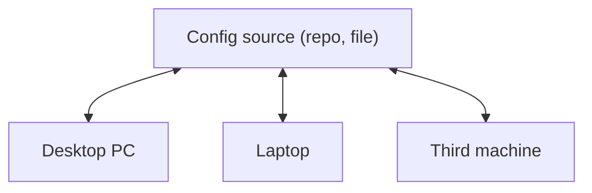

# rehome

Move your whole workstation to a new machine.

`rehome` scans an already configured system — apps, CLI tools, shell setup, app settings, AI tooling — and
generates a portable config. On a fresh machine, feed it the same config and it installs everything from scratch
or fills in whatever is missing, picking the right package manager for the detected OS.

> Supports Ubuntu, Debian, macOS and Ubuntu/Debian on WSL. No release yet — build from source.

## Install

```bash
git clone https://github.com/rchehd/rehome.git && cd rehome
CGO_ENABLED=0 go build -o ~/.local/bin/rehome ./cmd/rehome
```

Once releases are published: `curl -fsSL https://raw.githubusercontent.com/rchehd/rehome/main/install.sh | sh`.

## Usage

```bash
rehome                      # interactive menu: Scan / Install / Sync / Status / Pull / Push
rehome scan                 # detect software and settings, create or update the config
rehome install              # checklist of what is missing, then install it
rehome sync                 # pull the linked config and apply it with the install workflow
rehome status               # check the linked source and local system (exit 1 if out of sync)
rehome link <git-url>       # keep the config in your own private repo
rehome push / rehome pull   # sync it between machines
```

Every command takes `--dry-run`. `install` takes `--yes` for non-interactive runs, `--all` to reinstall what is
present, `--overwrite-files` to replace differing settings (a `.rehome.bak` is kept).

### Where the config lives

- a linked private git repo (`rehome link`) — the default once linked;
- a folder with `rehome.yml` and `files/`: `--config ~/backup/rehome-config` (USB stick, archive, anything);
- a single file: `--config ./rehome.yml` (settings come from `files/` next to it);
- a URL: `--config https://…/rehome.yml` (app list only; you are warned it is not your repo).

### Share a config across three machines

Any machine can update the config after you install a new tool. The other machines can then apply the update.



- **With Git**, run `rehome link <git-url>` once on each machine. On whichever machine made the change,
  run `rehome pull`, `rehome scan`, then `rehome push`. On any receiving machine, run `rehome status`
  to check for updates and `rehome sync` to pull and apply them. For an empty repo, start with `scan` and `push`.
- **With a file or folder**, start from the latest copy, run `rehome scan --config ./rehome-config` on the
  machine with changes, then share the updated `rehome.yml`. Include the adjacent `files/` to transfer settings
  and `rehome.lock` to transfer pinned versions. On a receiving machine, run
  `rehome sync --config ./rehome-config/rehome.yml` to apply that copy. You can also pass the folder.

If scan lists the tool as an unknown binary, add an install method and enable it before sharing the config.
`rehome status` reports the linked Git branch and local system separately. With `--config`, it compares
the supplied config with the local system.

## What it picks up

- **Packages:** apt (without the base OS, linked to third-party repos and their keys), snap, flatpak, Homebrew
  formulae, casks and taps, Mac App Store (with `mas`), global npm (nvm), pipx, uv tools, cargo, `go install`
- **Script installs** it knows from its catalog: Claude Code, Codex, oh-my-zsh and its plugins, uv, nvm, Go,
  JetBrains Toolbox, Zed, …
- **Settings:** zsh, oh-my-zsh custom, fonts, git, gh, Sublime Text, JetBrains, kitty, Ghostty, Zed, Claude Code
  and Codex (rules, skills, agents, hooks, MCP servers, plugins)
- **Unknown binaries** are listed disabled, so nothing is lost; add an install method to enable them

Settings of apps outside the catalog are found automatically in the usual places (`~/.config/<app>`, `~/.<app>`,
`~/.<app>rc`, flatpak and snap config dirs), skipping caches, logs and databases. They are recorded under `capture`
with `origin: auto`; edit or add your own rules there and the next scan follows them:

```yaml
capture:
  myapp:
    linux: { base: ~/.config/myapp, include: ["*.toml", "themes/**"] }
```

Anything rehome cannot take by itself — a settings folder too large to copy whole, a `~/.config` folder no app claims,
an unknown binary — is listed under **needs your attention** with what to do about it.

On Linux with GNOME and `dconf-cli`, `scan` also saves a text snapshot of desktop, Shell, Mutter, keyboard
shortcut and GNOME Terminal preferences. `install` restores those settings through `dconf-service` over D-Bus.
If a saved setting conflicts with a local value, the snapshot is kept unapplied unless you pass
`--overwrite-files`. That option saves a private backup and preserves settings outside the snapshot.

Captured settings replace detected tokens, passwords and keys with `<rehome:redacted>`. Before pushing,
`rehome push` checks the config for secrets.

### Restore a setting from Bitwarden

In your trusted local config, add a `bitwarden` reference to the file's existing mapping:

```yaml
files:
  myapp:
    - src: files/myapp/settings.env
      dest: {linux: ~/.config/myapp/settings.env, macos: ~/.config/myapp/settings.env}
      bitwarden: bw:12345678-1234-1234-1234-123456789abc/api_token
```

Put one `<rehome:redacted>` marker in the template, for example `API_TOKEN='<rehome:redacted>'`.
The reference uses the item's UUID and either a custom field name or `login.password`. Inline values support
letters, digits and `._~+/=@%:-`. Once you add the reference, edit the template in the config repo directly.
Future scans leave it alone.

With the Bitwarden CLI installed and logged in, run:

```sh
BW_SESSION="$(bw unlock --raw)" rehome install --bitwarden
```

The rendered file is written outside the config folder with permissions `0600`. To replace a differing local
file, add `--overwrite-files`. Without `--bitwarden`, install skips these mappings and reports them.

### Restore an SSH key from Bitwarden

Use the UUID of a Bitwarden SSH Key item. The key mapping stores only a reference and a filename:

```yaml
apps:
  - id: ssh
    files: ssh
files:
  ssh:
    - dest: {linux: ~/.ssh/id_work, macos: ~/.ssh/id_work}
      bitwarden: bw:12345678-1234-1234-1234-123456789abc/sshKey/privateKey
```

Run the same `rehome install --bitwarden` command. It writes the private key with mode `0600` and creates
`~/.ssh` with mode `0700` if needed. An existing key stays in place unless you pass `--overwrite-files`,
which keeps a private backup. The SSH catalog captures `~/.ssh/config` and `known_hosts` as regular settings.

## Using rehome on WSL

WSL uses the same config as Ubuntu and Debian. rehome restores terminal tools and their settings and points
you to Windows for catalogued graphical apps and fonts. For your own graphical apps, set `group: desktop`.
GNOME desktop settings are skipped on WSL. Snap and Flatpak are available to the installer only when systemd
is running. Scanning WSL does not mark intentionally skipped apps as missing in the shared config.

## Moving between Linux and macOS

A config made on Ubuntu installs on a Mac (and the other way round) without you looking up package names. When an
app has no installer for the current OS, rehome finds one: the built-in catalog first, then the same name in Homebrew
or apt, then known renames (`fd-find` → `fd`), then [Repology](https://repology.org). The plan marks these as
auto-mapped, and the next `rehome scan` on that machine records them. Apps that do not exist on the other OS are listed
with what to add; `--offline` keeps the lookup to the local package index. Homebrew is installed first if it is missing.

## How install behaves

- Installs in dependency order; one failing app never stops the rest, and the report says why it failed.
- Re-running is safe: present apps are skipped, local settings are never overwritten without asking.
- Third-party apt repos are retargeted to the new release; repos that fail are disabled and reported.

## Changing the config from the command line

```bash
rehome config add-install hermes --platform any --script 'curl -fsSL https://…/install.sh | bash' --bin hermes
rehome config add-capture myapp --base ~/.config/myapp --include '*.toml'
rehome config set steam enabled=false skip=macos
```

Comments in `rehome.yml` are kept, and a change that would make the config invalid is refused.

## Using with an AI agent

`rehome mcp` serves rehome to agents over MCP. Register it with every agent found on this machine
(Claude Code, Codex, Cursor) in one go:

```bash
rehome mcp install
```

For any other MCP client, add a stdio server with command `rehome` and argument `mcp`:

```json
{ "mcpServers": { "rehome": { "command": "rehome", "args": ["mcp"] } } }
```

The agent can scan, read status and what needs your attention, and fix the config (`add_install`, `add_capture`,
`set_app`). It never installs: installing needs `sudo` in your terminal, so the agent shows you the plan and the exact
command to run. Every command also takes `--json` for scripts.

## Versions

`rehome scan` also writes `rehome.lock` next to the config, with the version of every app it can read. On install:

- with a lock you choose the same versions or the latest (`--versions locked|latest`); without a lock you get the latest;
- a pinned version that is no longer available is replaced by the latest, and the report says so;
- installed apps are never downgraded; older ones are listed, and `--upgrade` (or `u` in the checklist) raises them;
- `version: 1.2.3` on an app pins it permanently; `--lock <file>` uses a lock kept elsewhere.

Keep apps off an OS or a machine:

```yaml
apps:
  - id: steam
    skip: [macos]
ignore:
  my-laptop: [docker, php8.1]
```

## License

[MIT](LICENSE)
